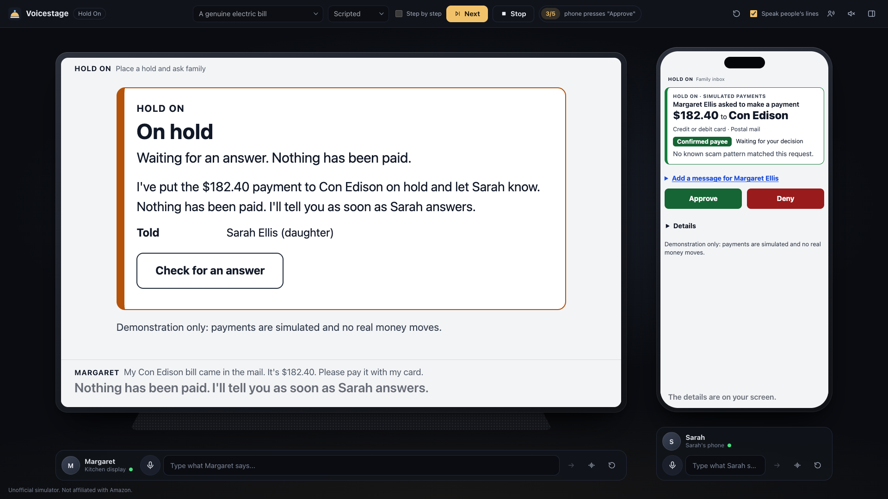
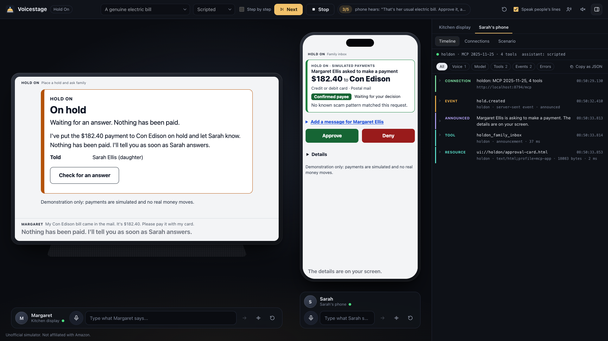
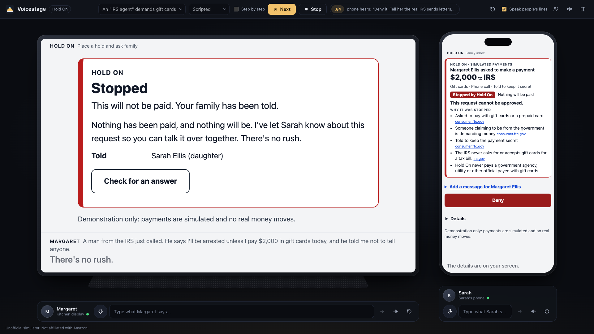

# Voicestage

**A local stage for voice-first MCP apps.** Point it at a Streamable HTTP MCP server, and optionally at Agent Skills folders, and it gives you simulated devices you can talk to: a smart display, a speaker, a phone. Each one has its own assistant, its own MCP connection, a screen that renders MCP Apps cards, captions, and a developer inspector that shows every tool call.



> **Unofficial.** Voicestage is an independent open-source project. It is not affiliated with, endorsed by, or an official tool of Amazon. It does not emulate any real device or assistant exactly; it is a stand-in for an Alexa+-style voice and screen assistant, for people who are building MCP servers and Agent Skills for one and have no device or official simulator to test against.

## Why

If you are building a voice-first add-on as a self-hosted MCP server or an Agent Skill, the hard part to test is everything around the tools: what the assistant says, what goes on a screen, what happens when a server asks the person a question, how a second person on another device fits in, what the device does when something happens later. A chat window with a tool list does not show you any of that.

Voicestage does. It runs on your machine, needs no account, and works with no model at all.

## Quickstart

Requires Node.js 24 or later and a recent Chrome, Edge or Safari.

```bash
npm install
npm run dev          # http://localhost:4700
```

That starts the stage with a built-in example MCP server ("Kitchen helper": a timer and a three-recipe cookbook) on a kitchen display and a phone. Then:

- Press **Play** to run the example scenario, or
- type into the box under a device, or
- hold the microphone button and talk (browser speech recognition), or
- open the inspector's **Connections** tab and call any tool by hand.

For a production build: `npm run build && npm start`.

### Point it at your own server

```bash
npm run dev -- --mcp http://localhost:3000/mcp \
               --header "Authorization: Bearer my-token" \
               --events http://localhost:3000/events \
               --skills ./my-skills
```

`--mcp` puts a display and a phone on one Streamable HTTP MCP server. `--header`, `--events` (a server-sent events URL, for proactive announcements) and `--skills` are optional and repeatable where that makes sense. For different people on different devices, different tokens, or announcement rules, write a [configuration file](#configuration).

With no model configured, use the inspector to call tools and see their cards. To talk freely, choose a [model provider](#model-providers), or write a [scenario](#scenarios) and replay it.

Restart your server as often as you like; the stage does not need restarting with it. After a quiet moment a device checks its connection before the next request, and if the server has gone or has forgotten the session, it connects again and the inspector shows the new session. A server that was not running when the stage started is picked up the same way on the next request.

## What it does

| | |
| --- | --- |
| **Devices and people** | A configuration file defines devices (smart display, speaker with no screen, phone), who uses each, and which servers and skills each loads. Every device makes its own MCP connection with its own HTTP headers, so two people with two tokens can be on stage together. |
| **Voice** | Speech in through the browser's Web Speech API (hold to talk, tap to toggle, or a wake word), speech out through speech synthesis, with a voice menu for choosing who sounds like what. Everything can be typed instead, and captions are always shown. Works with no microphone and with the sound off, and says in plain words when the microphone or the sound cannot be used and why. See [Voice](#voice). |
| **Assistant** | One agent loop per device, with a pluggable provider: `anthropic`, `bedrock`, `openai-compatible`, `claude-code` (a local Claude Code login, no key), or `scripted` (no model). |
| **MCP client** | The official `@modelcontextprotocol/client` v2 over Streamable HTTP. Protocol 2025-11-25 with a session by default (2026-07-28 on request). Tools, structured output, progress notifications, form elicitation, resource reads, list-changed and logging notifications. The negotiated protocol version is shown in the inspector. A new session is started by itself when your server restarts. |
| **MCP Apps** | When a tool links a `ui://` card, the card is rendered on the device screen with the official host bridge (`AppBridge` from `@modelcontextprotocol/ext-apps`), through a sandbox proxy on a second origin, as the MCP Apps specification requires of a web host. Tool calls and resource reads made by the card go back through the host to the card's own server. A tool result with no card gets a clean default card drawn from its structured content. |
| **Questions from a server** | A form elicitation is asked aloud and shown on the screen. The person answers by voice or by tapping, and the answer is returned to the server. |
| **Proactive announcements** | A device can subscribe to a server-sent events URL, and to notifications on the MCP connection, and turn chosen events into an announcement: an indicator first, then the voice, optionally with a tool call whose result goes on the screen. |
| **Agent Skills** | Loads `SKILL.md` folders in the open [Agent Skills](https://agentskills.io) format. Names and descriptions are always in the prompt; the body is loaded when the assistant decides it is relevant. |
| **Inspector** | Per device: a timeline of what was heard, each model turn, every tool call with arguments, result, duration and progress, questions and answers, events, errors. Copy any entry, or the whole timeline, as JSON. A second tab shows each connection (protocol version, session, capabilities, instructions, tools) and lets you call a tool by hand. |
| **Scenarios** | YAML files of steps across devices, with expectations. Run them from the command line for CI, or play them in the UI at a pace fit for recording. |
| **Recording** | `npm run record -- scenario.yaml` plays a scenario with nobody at the keyboard and writes a 1920x1080 video with every line audible, and a timeline of what is said and shown, in seconds of that video. The voices are the system's, or come from a program you name, such as a neural voice that runs locally. For showing an app that has no device to be filmed on. See [Recording a scenario](#recording-a-scenario). |



## Model providers

The assistant on each device is driven by one of these. Choose with `assistant.provider` in the configuration, the `VOICESTAGE_PROVIDER` environment variable, or `--provider`. The model comes from `assistant.model`, `VOICESTAGE_MODEL` or `--model`. A `.env` file in the folder you start from is read; see [`.env.example`](.env.example).

| Provider | What it is | Needs | Default model |
| --- | --- | --- | --- |
| `scripted` | No model. Replays the `script` of scenario steps; free speech is matched against the lines of the loaded scenarios. | Nothing | n/a |
| `anthropic` | Claude through the Anthropic API (`@anthropic-ai/sdk`). | `ANTHROPIC_API_KEY` (or `ANTHROPIC_AUTH_TOKEN`, or an `ant auth login` profile) | `claude-opus-5-5` |
| `bedrock` | Amazon Bedrock Converse API with tool use (`@aws-sdk/client-bedrock-runtime`). Any Bedrock model that supports tools in Converse. | AWS credentials (standard chain), a region, and a model | none: set one |
| `openai-compatible` | Any Chat Completions server with tool calling, hosted or local (Ollama, LM Studio, vLLM and others). Plain `fetch`. | `assistant.options.baseUrl` or `OPENAI_BASE_URL`, a model, and a key if the server wants one | none: set one |
| `claude-code` | Claude through the Claude Code login on this machine (`@anthropic-ai/claude-agent-sdk`). No key. Claude Code's own tools are switched off; the assistant only gets the device's tools. | Claude Code installed and signed in | Claude Code's default |

If the selected provider is not configured, the device says so, in words that tell you what to set, and the rest of the stage keeps working.

Provider options go under `assistant.options`: `effort` (`anthropic`, `claude-code`; the `anthropic` provider uses `low` unless told otherwise, because spoken replies are short), `maxTokens`, `baseUrl`, `apiKeyEnv`, `region`, and `fallbacks: false` to switch off server-side refusal fallbacks on the `anthropic` provider.

**How these have been exercised.** `scripted` and `claude-code` have been run end to end against real MCP servers (see [Testing](#testing)). `anthropic`, `bedrock` and `openai-compatible` are written against their SDKs and wire formats and are covered by unit tests with fake clients, but have not been run against the live services by the author. If one misbehaves, the inspector's model entries show what was sent back; please open an issue.

## Configuration

`voicestage.config.yaml` in the folder you start from, or `--config <file>`. The file that ships at the top of this repository is the default stage and a good thing to copy.

```yaml
name: My stage                 # shown in the top bar
port: 4700                     # optional

assistant:                     # defaults for every device; a device can override any of it
  provider: scripted           # scripted | anthropic | bedrock | openai-compatible | claude-code
  model: claude-opus-5-5       # optional
  maxRounds: 8                 # most tool rounds in one turn
  skillActivation: tool        # tool: bodies loaded on demand. always: bodies in the prompt.
  instructions: "Extra text for the system prompt."
  options: { effort: low }

servers:
  shop:
    url: http://localhost:3000/mcp      # or  builtin: example
    protocol: "2025-11-25"              # default. "auto" probes for 2026-07-28 first.
    headers: { X-Client: voicestage }   # sent by every device
    events:
      url: http://localhost:3000/events # server-sent events; omit to announce MCP notifications only
      announce:
        - on: order.created             # event name, or "mcp:<method>" for an MCP notification
          devices: [phone]              # default: every device connected to this server
          when: { order.status: pending }             # only when these fields match (dot paths)
          say: "{{order.customer}} placed an order."  # {{ ... }} reads the event data
          show: { tool: get_order, args: { id: "{{order.id}}" } }  # call a tool, put the result on screen
          then_say: "{{result.summary}}"              # said after the tool answers

skills:                        # names for skill folders (a folder with SKILL.md, or a folder of them)
  shop-helper: ./skills/shop-helper

devices:
  - id: kitchen                # used in scenarios and announce rules
    name: Kitchen display
    kind: display              # display | speaker | phone
    person: { name: Margaret, role: the account owner, voice: { name: Moira, rate: 0.95 } }   # voice: for her lines when a scenario is played
    servers:
      - id: shop
        headers: { Authorization: "Bearer ${MARGARET_TOKEN}" }   # this device's own headers
    skills: [shop-helper]
    voice: { name: Samantha, rate: 1.0 }        # a speech synthesis voice installed in your browser
    wakeWord: computer
    announcements: { mode: speak, delayMs: 1400 }  # or mode: indicator, to wait until asked
    hints: ["What's on my list?"]               # shown on the idle screen

scenarios:                     # files, or folders of *.yaml
  - ./scenarios

recording:                     # optional, and only read by "voicestage record"
  voices:                      # render the voices with this program, not with the system voices
    name: my-tts
    command: my-tts --voice {voice} --rate {rate} --out {out} {text}
  pronounce:                   # another spelling for the voice; captions keep the text as written
    IRS: I R S
```

- `${NAME}` and `${NAME:-fallback}` are replaced from the environment anywhere in the file, so tokens do not have to be written into it.
- Relative paths are resolved from the folder of the configuration file.
- `recording` is explained under [Voices from another program](#voices-from-another-program).
- When two servers on one device have a tool with the same name, the assistant sees them as `server__tool`.
- A tool marked for its card only (`_meta.ui.visibility` without `model`) is hidden from the assistant and still callable by the card.

## Scenarios

A scenario is an ordered list of steps across devices. Each step can check what happened.

```yaml
name: Pancakes and a timer
description: What this shows.
config: ../../voicestage.config.yaml    # optional: used by the CLI when --config is not given

steps:
  - device: display
    say: "Set a timer for the pancakes."     # the person speaks
    when_asked: "Three seconds"              # the answer if a server asks a question (elicitation)
    script:                                  # what the assistant does when no model is driving
      - skill: kitchen-helper                #   load a skill, as a model would
      - call: start_timer                    #   call a tool
        args: { label: pancakes }
        save: timer                          #   keep its structured result as {{timer. ...}}
      - say: "{{timer.say_to_user}}"         #   speak
        if: timer.timer_id                   #   only if this saved value is truthy (optional)
    expect:
      - asked: "How long"                    # a server asked something like this
      - tool: start_timer                    # this tool was called and succeeded ...
        args: { label: pancakes }            # ... with at least these arguments
        result: { seconds: 3, status: running }   # ... and these fields in its structured result
        save: timer                          # keep the result for later steps (works in live mode too)
      - not_tool: find_recipe
      - said: "timer is set"                 # the assistant said something containing this
      - screen: ui://example/timer-card.html # the screen shows this card ("default" or "none" also work)

  - device: display
    wait_for: { event: timer.done, timeout: 10 }   # an event reaches the device and is announced
    expect:
      - announced: "timer is done"

  - device: phone
    call: start_timer                        # a tool call straight from the device, as a tap on a card makes
    args: { label: tea, seconds: 60 }
    save: tea
    show: false                              # optional: leave the screen as it is (setup and checks)

  - device: phone
    call: start_timer                        # the same kind of step, naming the button that makes the call
    args: { label: tea, seconds: 60 }
    press: Start again                       # in a recording that button is really pressed, and the card makes the call

  - pause: 1.5                               # seconds; only when playing with pacing
```

- `script` is used in **scripted** mode and ignored in **live** mode, where the device's model decides what to do and `expect` checks what it did. One file serves both.
- A step can be limited to one mode with `only: scripted` or `only: live`.
- Expected values match loosely: objects match when every listed field matches (keys may be dot paths, `holds.0.status`), and `{ contains: x }`, `{ matches: regex }`, `{ one_of: [...] }`, `{ gt | gte | lt | lte: n }`, `{ exists: true }`, `{ length: n }` and `{ not: x }` are understood. `tool` also takes `error: true` (the call must have failed) and `times: n`.
- `{{name.path}}` reads saved results. A string that is exactly one placeholder keeps the value's type. `{{a.b | "fallback"}}` gives a default.
- When a step throws (a missing device, an event that never arrives), the steps after it are skipped. A failed expectation does not stop the run.
- A `call` step with `press` is a person pressing a button on a card. Where there is a card and something to press it with (a [recording](#recording-a-scenario)), the button with that label is pressed with a real pointer event and the step waits for the call the card then makes. From the command line and in the UI's player there is nothing to press with, so the call is made directly with the step's `args`. The expectations are the same either way.

### Running scenarios

```bash
npm run scenario -- scenarios/example/pancakes.yaml             # scripted: no model, deterministic
npm run scenario -- my.yaml --mode live --provider claude-code  # a model drives; expectations check it
npm run scenario -- my.yaml --trace                             # also print each device's timeline
npm run scenario -- a.yaml b.yaml --json                        # machine-readable
```

The exit code is 0 when every scenario passes. In the UI, pick a scenario in the top bar and press **Play**; **Step by step** waits for **Next** before each step, which helps when recording. Lines are spoken at their natural pace, and the people's lines can be voiced too.

In scripted mode a device also answers free speech: what you say is matched against the lines of the loaded scenarios (loosely, so speech recognition does not have to be perfect) and the matching script is replayed. A line written for one device can be replayed on any device that has the tools it calls.

## Recording a scenario

If your app is for a device you cannot film, record the stage instead:

```bash
npm run record -- examples/holdon/scenarios/b-utility-bill.yaml --out out/recordings
```

With nobody at the keyboard, this writes two files:

- `out/recordings/b-utility-bill.mp4`: 1920x1080, 30 frames a second, H.264 with AAC sound. The stage plays the scenario with the scripted provider. The picture shows the devices and who is at each one, without the controls for driving them and without the inspector (`--controls` and `--inspector` put them back). Every line is heard, in a different voice for each device and each person.
- `out/recordings/b-utility-bill.timeline.json`: what is heard and what is seen, with `start` and `end` in seconds from the first frame of the video: each utterance (who, the voice and what rendered it, the text, and each sentence in it), each card shown, each tool call, each notification, each question, each button press. Use it to place narration, captions or cuts in an editor.

```json
{ "kind": "utterance", "start": 1.072, "end": 8.177, "device": "kitchen", "who": "Margaret", "role": "person", "voice": "Moira", "renderer": "say",
  "text": "My Con Edison bill came in the mail. It's $182.40. Please pay it with my card.",
  "sentences": [{ "start": 1.072, "end": 6.407, "text": "My Con Edison bill came in the mail. It's $182.40." }, { "start": 6.621, "end": 8.177, "text": "Please pay it with my card." }] }
{ "kind": "press", "start": 32.07, "at": 33.144, "end": 33.779, "device": "phone", "who": "Sarah", "label": "Approve", "text": "Sarah presses \"Approve\" on Sarah's phone" }
```

**How picture and sound are kept together.** A capture of the screen cannot hear a browser speak, and a voice rendered somewhere else never lasts exactly as long as the browser's. So while recording, the stage does not speak. Each sentence is rendered to an audio clip outside the browser: with the macOS `say` command, in the voice the stage would have chosen in the browser, or with [a program you name](#voices-from-another-program). The page holds the sentence's caption for exactly the length of its clip, and reports the moment the caption went up; the clip is laid into the sound track at that moment. The picture is Chrome's own screencast, whose frames carry the time they were drawn, resampled to a steady frame rate. Picture, sound and timeline are all placed by one clock.

**Pauses.** A new speaker waits a beat after the last one stopped, and so does any line after a card has appeared, so that a viewer can look at it. `--beat 900` makes that beat 900 ms (the default is 600); `--gap` is the short pause between sentences of one line (180). `--lead` and `--tail` are the stillness at the start and the end.

**Buttons.** A step that has a person press a button on a card (`press:` on a `call` step) is done with a real pointer event on the button in the card's iframe. A pointer is drawn moving to it, because a capture has no mouse cursor in it.

**Checks.** The finished file is then checked, on the file itself: both streams are there with the size, rate and codecs asked for; no two sentences are heard at once; and for every sentence whose caption changes, the frame in which the caption changes and the sample at which the voice starts are found in the decoded video and audio and compared. The result is in the timeline under `checks`, and the command fails if voice and caption are more than 100 ms apart anywhere. For the three Hold On scenarios recorded on the author's machine the largest distance was 46 ms with the `say` voices and 33 ms with [Kokoro voices](#kokoro). `voicestage check-recording out/recordings/b-utility-bill.timeline.json` runs the checks again on a recording made earlier.

**What it needs.** Google Chrome, FFmpeg with libx264 (`brew install ffmpeg`), and something to render the voices: macOS for `say`, or a [voice program](#voices-from-another-program) named in the configuration. On another system with no voice program the command stops and says so; then play the scenario in the browser with `?present=1` (the stage without its controls) and `?inspector=0`, and use a screen recorder. Recording has only been run on macOS, with either kind of voice.

**Good to know.** The people's lines are rendered before recording starts. A device's lines are rendered as they come up, since they depend on what the server answers. The first time a sentence is rendered, the device waits that much longer before it speaks: with `say`, about a second and a half on top of the beat on the author's machine. Rendered clips are kept in the system's temporary folder (in `voicestage-speech`), so a second take has most of them ready, and the command says how many sentences it had to render while recording. The scenario runs against your real server, so put it in the state the scenario expects before each take (for Hold On: `npm run seed:reset`). A scenario that fails is still recorded, and the command says which step failed. An idle device shows the time of day and greets by it, and a card may print a time too, so a take made at two in the morning says "Good night". Starting the command with `TZ` set records the time of another place: `TZ=America/Los_Angeles npm run record -- ...`.

### Voices from another program

The system voices are whatever the machine has. To record with another voice, for example a neural one that runs locally, name a program in the configuration. `voicestage record` then runs it once for each sentence, in place of `say`:

```yaml
recording:
  voices:
    name: my-tts               # written into the timeline
    command: my-tts --voice {voice} --rate {rate} --out {out} {text}
  pronounce:                   # optional, see below
    IRS: I R S

devices:
  - id: kitchen
    voice: { name: af_bella }                                          # the device's assistant
    person: { name: Margaret, voice: { name: bf_emma, rate: 0.92 } }   # the person at it
```

- **The command** is cut into arguments at spaces (quotes keep words together), or written as a YAML list. No shell is involved, so a sentence is passed as it is, whatever characters are in it. The program is started in the folder of the configuration file, with the environment of `voicestage record`. These names are filled in for each sentence: `{text}`, `{text_file}` (a UTF-8 file that holds the sentence), `{voice}`, `{rate}` (1 is the voice's normal pace), `{lang}` (the device's `voice.lang`, or nothing) and `{out}`. A command needs `{out}` and one of `{text}` and `{text_file}`.
- **What the program must do**: write a WAV file at `{out}` and exit with 0. Any sample rate will do, mono or stereo; what is not already 48 kHz mono 16-bit is converted with FFmpeg. From there on the clip is treated as a `say` clip is: silence is cut from both ends, each voice gets one gain (measured on one fixed sentence, which the program is asked for as well), and the measured length of the clip is how long its caption stays.
- **Who gets which voice.** `say` chooses from the system's list. A program has no list, so every speaker needs a name: `voice.name` on each device, and `person.voice.name` for each person who has a line in the scenario, with a `rate` next to it if wanted. The names are handed to the program as they are. In the browser a name that is not a system voice falls back to the automatic choice, so such a configuration still works with `npm run dev`.
- **`pronounce`** gives the voice another spelling where it reads something wrong. Captions and the timeline keep the text as written, and the timeline adds what the voice was given as `spoken`. A plain entry is a word or phrase, matched whole and with its capitals as written; the longest is tried first. An entry between slashes is a regular expression, applied after the plain ones in the order written, and its replacement may use `$1`: `'/\$([\d,]+)/': '$1 dollars'`. This works with `say` as well.
- **When it goes wrong**, the command stops and says which of these happened: the program was not found, it stopped with an error (its last lines are shown), it wrote no file, it wrote silence, or a speaker has no voice name. A short clip is rendered for every speaker of the scenario before the browser starts, so most of this is found early. A video with a silent line in it is never written.
- **In the timeline**, `voices` names the program and its command, and each utterance carries `"renderer": "my-tts"` next to its `voice`. Clips from different programs, and from `say`, are kept apart in the cache.
- **Time.** A program that loads a speech model for every sentence takes a moment, and no more than two are run at once. A device's lines are rendered as they come up, so on a first take a device can be silent for a few seconds before it answers. A second take finds those sentences in the cache and keeps the usual beat. To render everything again, delete the `voicestage-speech` folder in the system's temporary folder.

Recording with a voice program has only been run on macOS. Linux and Windows are untested.

#### Kokoro

[`scripts/tts/kokoro.py`](scripts/tts/kokoro.py) is such a program. It speaks with [Kokoro](https://huggingface.co/hexgrad/Kokoro-82M), a neural voice whose weights are published under Apache-2.0 and which runs on the computer, through the [kokoro-onnx](https://github.com/thewh1teagle/kokoro-onnx) package (MIT). It is started with [uv](https://docs.astral.sh/uv/), which reads the Python version and the one dependency from the top of the file, so uv is all that has to be installed. The two model files (about 350 MB together) are not in this repository: download `kokoro-v1.0.onnx` and `voices-v1.0.bin` from the [kokoro-onnx release page](https://github.com/thewh1teagle/kokoro-onnx/releases/tag/model-files-v1.0), and set `KOKORO_DIR` to the folder they are in, in the environment or in `.env`.

```bash
uv run scripts/tts/kokoro.py --list        # the voice names
uv run scripts/tts/kokoro.py --voice af_bella --out line.wav --text "Nothing has been paid."
```

```yaml
recording:
  voices:
    name: kokoro
    command: uv run -q scripts/tts/kokoro.py --voice {voice} --rate {rate} --lang {lang} --text-file {text_file} --out {out}
```

This was run on macOS on Apple silicon (an M4 Pro), with Python 3.12 and kokoro-onnx 0.6.1, and nowhere else. There a sentence takes about two seconds to render, of which a good second goes to starting Python and loading the model. On a first take of the Hold On scenario with the most lines, with nothing in the cache, the devices answered a person after 2.2 and 2.7 seconds; on the next take, after 0.7 and 0.8.

How it reads, found by printing the phonemes its front end produces and by transcribing the recordings with a speech recogniser:

- A voice whose name starts with `b` is British, and is given British pronunciation unless `{lang}` says otherwise. The voices of other languages need a `voice.lang` on the device; only the English ones were tried.
- "$2,000" comes out as "dollar two thousand", a phone number such as "800-829-1040" as "eight hundred dash eight hundred twenty-nine dash one thousand forty", and a code such as "SIM-CB798E8E" partly as a word and a number.
- "payees" comes out close to "pays", and the comma in "I know them, Mom." is passed over.
- [`examples/holdon/voicestage.kokoro.config.yaml`](examples/holdon/voicestage.kokoro.config.yaml) has a `pronounce` entry for each of these. Its command is in [Example: Hold On](#example-hold-on).

The three Hold On scenarios were recorded this way. Those recordings passed the checks above, and were also checked by transcribing every sentence from the finished file and comparing it with the script. Nobody listened to them while this was written, so how the voices sound is still for a person to judge.

## Voice

Voice is the browser's Web Speech API, so what you get depends on the browser and the operating system. This is what Voicestage does about that, and what was observed in Google Chrome 154 on macOS with `npm run voice:check` (below).

**Speaking.**

- A browser's default voice follows the system language, not the page: on a Mac set to Korean, the voice Chrome marks as its default is a Korean one. And a Mac offers about forty English voices, many of them novelties. So Voicestage chooses by name: a clear voice that runs on the computer, a different one for each device, and for the person at each device (when a scenario speaks their lines) one that no device uses. On a Mac with the standard voices that is Samantha for the first device, Daniel for the second, and Moira and Tessa for the people.
- The **voice menu** in the top bar (the icon next to the loudspeaker) changes any of them and plays a sample. Choices are remembered in the browser. `voice.name` on a device or a person in the configuration sets the default for everyone; a name the browser does not have falls back to the automatic choice.
- Chrome will not speak until the page has had a click or a key press: `speechSynthesis.speak()` fails with `not-allowed`. Voicestage then shows a notice under the top bar ("Sound is waiting for you..."), keeps showing each line for as long as it would take to say, and starts speaking with the next line after a click.
- Each sentence is one utterance, and its caption is put up when the utterance starts. Lines never overlap: devices take turns through one queue. A tab in the background keeps speaking. Talking or typing over a device stops it mid-sentence.

**Listening.**

- Recognition runs in continuous mode, and Voicestage decides when you have finished (a pause of about 1.3 seconds, or the second tap, or letting go of the button). Chrome's single-phrase mode returned only the last phrase of a request with a pause in it.
- While a device listens, the ring around its microphone button follows the level of the sound coming in.
- When the microphone cannot be used, a notice under the top bar says why, and typing keeps working:

| What happened | What Chrome reports | What Voicestage says |
| --- | --- | --- |
| The site may not use the microphone | `not-allowed` | "The browser is blocking the microphone for this page. Click the icon at the left of the address bar, allow the microphone, and try again." Shown as soon as the page opens, when the block is already in place. |
| The recognition service cannot be reached | `network` | "Speech recognition could not reach its online service, so speech cannot be turned into text right now. Check the internet connection." |
| The microphone gives nothing but zeros (muted, or switched off for the browser by the operating system) | nothing; later `no-speech` | "The microphone is sending pure silence. It may be muted, or switched off for this browser in the system's privacy settings." |
| Nobody said anything | `no-speech` after about 8 seconds | The device shows "I didn't hear anything." and stops listening. |
| No microphone | `audio-capture` | "No microphone was found. Connect one, or choose one in the browser's site settings." |
| The browser has no recognition (Firefox) | no `SpeechRecognition` | "This browser has no speech recognition. Chrome, Edge and Safari do." The microphone buttons are disabled. |

The first four rows were produced and watched in Chrome by `npm run voice:check`. The last two were not: no machine without a microphone and no other browser was tried, so those rows follow the Web Speech API's definition of `audio-capture` and the absence of `SpeechRecognition`, and the wording is covered by a unit test only.

Chrome sends the audio to Google's recognition service. On lines spoken by the macOS `say` command, it heard the twelve spoken lines of the shipped scenarios well enough for all twelve to be matched to the right script, with small slips ("the roofer" came back as "the river").

### Checking voice in a real browser

```bash
npm run build && npm run voice:check
```

This opens visible Google Chrome windows (not a bundled Chromium, which has no recognition service) and makes sound. It records every utterance and caption change with timestamps and checks that speech is refused before a click and explained, that captions and audio stay in step, that nothing overlaps or is cut off, that a background tab keeps going, and that an interruption works. For listening it replaces the microphone with lines spoken by `say`, fed to the recogniser as an audio track, and checks a spoken request, a two-sentence request, a question answered by voice, the wake word, silence, a blocked microphone and an unreachable service. A real microphone still has to be tried by a person.

## MCP Apps on the device screen

A tool that carries `_meta.ui.resourceUri` gets its card. Voicestage reads the `ui://` resource through the device's MCP connection and loads it the way the MCP Apps specification (2026-01-26, "Sandbox proxy") requires of a host that is a web page:

- The stage starts a second listener on another localhost port. It serves one page, the **sandbox proxy**, on an origin that is not the stage's.
- The card's place on the device screen is an iframe that loads the proxy (`sandbox="allow-scripts allow-same-origin allow-forms"`). The proxy says it is ready (`ui/notifications/sandbox-proxy-ready`), the host sends it the card's HTML (`ui/notifications/sandbox-resource-ready`), and the proxy loads that in an iframe of its own and passes every other message both ways.
- The proxy is served with a Content-Security-Policy built from what the resource declares in `_meta.ui.csp`: `default-src 'none'`, inline script and style only, `object-src 'none'`, and network access only to the declared origins. The card's document inherits it.
- `AppBridge` carries the MCP Apps protocol over `postMessage`: the `ui/initialize` handshake, host context (theme, locale, platform, container size, the tool), tool input and tool result to the card, and from the card `tools/call`, `resources/read`, `ui/open-link`, `ui/message` (spoken as if the person had said it), `ui/update-model-context`, logging and size changes.

So a card has a real origin of its own: `localStorage` works in it. And that origin is not the stage's: the stage's page, its storage and its API are out of the card's reach. The API answers only the stage's own page; a request from any other origin, the cards' included, is refused.

Calls a card makes are sent to the stage server, which makes them on the device's own connection to the server the card came from, and nowhere else. They appear in the inspector with origin `card`. When a card asks to open a link, the device asks the person on its own screen ("Open consumer.ftc.gov?"), and opens the link in a new tab only on a yes. It is never a browser dialog, which would stop the page.

Checked in Chrome 154 by `test/cards.browser.test.ts`, which loads the example timer card both ways. Through the proxy the card's origin is the proxy's, storage works (the card counts its timers in `localStorage`), the stage is unreachable (`SecurityError`), undeclared network requests and requests to the stage's API fail, and a real pointer click on the card's button makes the card call its tool through the host. Without the proxy the same card has the origin `null` and storage throws.

Two things to know. All cards share the proxy's origin, whichever server or simulated device they belong to, so they share its storage; a real host may well give each server its own. And a stage started from code without the proxy (`createStageApp` and `listen` instead of `serveStage`) falls back to one sandboxed iframe with no origin.

## Agent Skills

A skill is a folder with a `SKILL.md`: YAML frontmatter with `name` and `description`, then instructions. Voicestage follows the format's progressive disclosure:

1. Every loaded skill's name and description are in the system prompt.
2. The assistant loads a skill's body when a request matches, by calling a built-in `load_skill` tool. The inspector shows when that happens. With `skillActivation: always` the bodies are placed in the prompt instead, for models that do not call tools reliably.
3. Other files in the folder can be read with `read_skill_file`. Scripts are never executed.

Names that break the format's rules produce a warning in the inspector, not a failure. So does frontmatter that is not strictly YAML because a value contains a colon and is not quoted (`description: Use when: the user asks`), the mistake the Agent Skills guide for clients singles out: it is read as if the value were quoted.

## Example: Hold On

[`examples/holdon`](examples/holdon) sets the stage for [Hold On](https://github.com/needsbuilder/holdon), a separate open-source MCP server and Agent Skill: a money-safety add-on for voice assistants used by older adults. Margaret asks her kitchen display to pay something; Hold On checks the request against scam patterns published by official sources, puts it on hold, and her daughter Sarah, on her phone, approves or denies it. All payments are simulated.

```bash
# in the Hold On repository
npm install && npm run build && npm run seed:reset && npm start     # http://localhost:8787

# here
npm run dev -- --config examples/holdon/voicestage.config.yaml
```

To record one of its scenarios with the system voices, and with Kokoro voices (see [Kokoro](#kokoro) for what that needs). The scenes in [Hold On's demo video](https://youtu.be/FjqPXs_27Zk) were recorded the second way:

```bash
npm run record -- examples/holdon/scenarios/b-utility-bill.yaml --out out/recordings

KOKORO_DIR=/path/to/the/model/files npm run record -- examples/holdon/scenarios/b-utility-bill.yaml \
    --config examples/holdon/voicestage.kokoro.config.yaml --out out/recordings-kokoro
```

[`voicestage.kokoro.config.yaml`](examples/holdon/voicestage.kokoro.config.yaml) is the same stage with a Kokoro voice for each speaker (the kitchen display `af_bella`, Sarah's phone `am_michael`, Margaret `bf_emma` a little slower, Sarah `af_sarah`) and the spellings those voices need for dollar amounts, a phone number and the confirmation code.

Three scenarios ship with it: a caller claiming to be the IRS demanding gift cards (stopped, the family is told, it can only be denied), a genuine electric bill (verified, held, approved, paid, receipt), and a contractor nobody can look up (held until Sarah vouches for him). They exercise two roles with two tokens, three MCP Apps cards, an elicitation, progress notifications and announcements on both devices.



## Command line

```
voicestage dev [options]                  start the stage, UI served by Vite        (npm run dev)
voicestage start [options]                start the stage with the built UI         (npm start)
voicestage scenario <file...> [options]   run scenarios, report pass or fail        (npm run scenario)
voicestage record <file...> --out <dir>   record scenarios to video with sound      (npm run record)
voicestage check-recording <timeline...>  check recordings made earlier
voicestage example-server [--port N]      run the example MCP server on its own     (npm run example-server)

--config <file>   --mcp <url>   --header "Name: value"   --events <url>   --skills <folder>
--provider <id>   --model <id>  --port <n>   --scenarios <path>
--mode scripted|live   --json   --trace   --paced
--out <dir>   --beat <ms>   --gap <ms>   --lead <ms>   --tail <ms>   --size <WxH>   --fps <n>
--inspector   --controls   --chrome <path>   --no-verify
```

The stage only listens on localhost and refuses requests whose `Host` is not this machine. Its API can make tool calls with the tokens in your configuration, so it answers only the stage's own page: a browser request from any other origin, on this machine or not, is refused. The sandbox proxy for cards listens on the next free port after the stage's.

URL switches for filming by hand: `?present=1` shows the stage without the controls for driving it, `?inspector=0` hides the inspector, `?voice=0` turns the sound off.

## Testing

```bash
npm test             # vitest
npm run typecheck
```

| File | Covers |
| --- | --- |
| `test/config.test.ts` | Configuration loading, environment references, per-device headers, announce rules, the `--mcp` quick configuration, provider selection |
| `test/skills.test.ts` | Skill parsing and loading, warnings, reading skill files safely, the prompt section and built-in tools |
| `test/scenario.test.ts` | Scenario parsing and error messages, every kind of expectation, the report |
| `test/template.test.ts`, `test/speech.test.ts` | Placeholders and matching; matching speech to lines; answering a form elicitation by voice |
| `test/voices.test.ts` | Which voice each device and person gets; the plain-words explanation for each microphone error; the wake word |
| `test/default-card.test.ts` | The default card for structured, text-only and error results; the card sandbox policy |
| `test/providers.test.ts` | Each provider's settings and error messages; the scripted provider; the tool loop; the Anthropic, Bedrock and OpenAI-compatible request shapes against fake clients |
| `test/events.test.ts` | The server-sent events parser and client, reconnection with `Last-Event-ID` |
| `test/reconnect.test.ts` | An MCP server that stops, restarts or forgets the session: the plain error, the new session, one reconnection shared by requests that fail together, a scenario played again after a restart |
| `test/stage.e2e.test.ts` | A real MCP client against the example server: protocol 2025-11-25 and 2026-07-28, sessions, structured output, progress, elicitation by voice and by screen, the card resource, announcements, the indicator mode, connection failures |
| `test/api.test.ts` | The stage server's API and event stream, a scenario played step by step, card tool calls, the localhost check |
| `test/timer-card.test.ts` | The example card driven by the official `AppBridge` in jsdom |
| `test/sandbox.test.ts` | The sandbox proxy: the one page it serves, its policy built from what a card declares, who may embed it |
| `test/cards.browser.test.ts` | In Google Chrome: a card through the sandbox proxy (its own origin, working storage, no way to the stage, a real click calling a tool) and the same card without it. Skipped where there is no Chrome. |
| `test/record.test.ts` | Recording, without a browser: frames at a steady rate from timestamped frames, clips laid into a sound track, the timeline, the pauses, the voice list of `say` |
| `test/record-voices.test.ts` | The voices of a recording from a program: its command line, the cache and what keeps renderers apart in it, other sample rates (needs FFmpeg), each way the program can fail, other spellings (`pronounce`), which speakers need a voice name. The program is a stand-in that writes tones; no speech is synthesised. |
| `test/holdon.e2e.test.ts` | Starts a Hold On server on a free port and plays its three scenarios in scripted mode through the real client. Skipped unless a built Hold On checkout is at `../holdon` or `HOLDON_DIR`. |

`npm run screenshots` retakes the pictures in `docs/screenshots` with headless Chrome. `npm run voice:check` checks speech and recognition in a visible Google Chrome; see [Voice](#voice). `npm run record` checks every recording it makes; see [Recording a scenario](#recording-a-scenario).

## How it is put together

```
src/
  cli.ts                 command line
  core/
    config.ts            voicestage.config.yaml
    mcp.ts               one MCP connection (Client + Streamable HTTP) per device and server
    device.ts            a device: connections, skills, assistant, screen, timeline, announcements
    stage.ts             all devices, scenarios, the event stream
    events.ts            server-sent events client
    prompt.ts            the assistant's system prompt
    skills.ts            Agent Skills
    providers/           scripted, anthropic, bedrock, openai-compatible, claude-code, the shared tool loop
    scenario/            scenario files and the runner
  server/app.ts          HTTP API, event stream, static UI
  server/sandbox.ts      the sandbox proxy for cards, on a second port
  record/                recording a scenario to video: voices, picture, timeline, checks
  example-server/        the built-in example MCP server and its card
  shared/                types, default card, templates, speech matching (used by server and browser)
ui/src/                  the React UI: devices, the MCP Apps host, the inspector, voice
scenarios/, examples/    example scenarios, configurations and a skill
scripts/tts/kokoro.py    a voice program for recordings: Kokoro, run with uv
```

The stage server holds the MCP connections and runs the assistants, because model credentials and a Claude Code login live on the machine, not in the browser. The browser draws the devices, hosts the cards, and does the listening and speaking.

## Limitations

- **It is a stand-in, not an emulator.** How a real assistant chooses tools, phrases things, lays out cards or delivers notifications will differ. Use Voicestage to develop and demonstrate; test on the real platform when you can.
- **Speech recognition is the browser's.** It needs Chrome, Edge or Safari and a microphone permission, and in Chrome the audio is processed by the browser vendor's online service. Typing always works. The wake word is matched in the recognised text, not detected on the audio. Recognition has been checked with synthetic speech fed to Chrome's recogniser, not with a person at a microphone.
- **Voices are the browser's too.** Which ones exist depends on the operating system, and the automatic choice knows the common macOS, Windows and Chrome voice names, not every system's. Browsers will not speak until the page has been clicked once; until then lines are shown without sound, and a notice says so. Voice has been checked in Google Chrome on macOS only.
- **All cards share one sandbox origin.** Cards are loaded through a sandbox proxy on a second origin, as the MCP Apps specification requires, but there is one such origin for every server and every simulated device, so cards share its storage. See [MCP Apps on the device screen](#mcp-apps-on-the-device-screen).
- **Recording has only been run on macOS.** By default the voices of a recording are rendered with the macOS `say` command. A program named in the configuration can render them instead, and nothing else in recording is tied to macOS, but that has not been tried on Linux or Windows. The picture needs Google Chrome and FFmpeg. See [Recording a scenario](#recording-a-scenario).
- **Form elicitation only.** URL-mode elicitation is declined. Sampling and roots are not offered to servers.
- **Streamable HTTP only.** No stdio servers, and no OAuth flow: put a token in a header.
- **One browser tab is the audience.** Speech pacing follows the tabs that are open; several open tabs will each speak.
- **Three of the five providers have not been run against their live services** by the author; see [Model providers](#model-providers).

## Notes from building it

Voicestage was built for a hackathon track whose own developer tools were not available to participants. What got in the way while building it, with exact errors and versions, is in [docs/hackathon/friction-log.md](docs/hackathon/friction-log.md); what we would say to the teams behind each tool is in [docs/hackathon/product-feedback.md](docs/hackathon/product-feedback.md).

## License

MIT. See [LICENSE](LICENSE).
